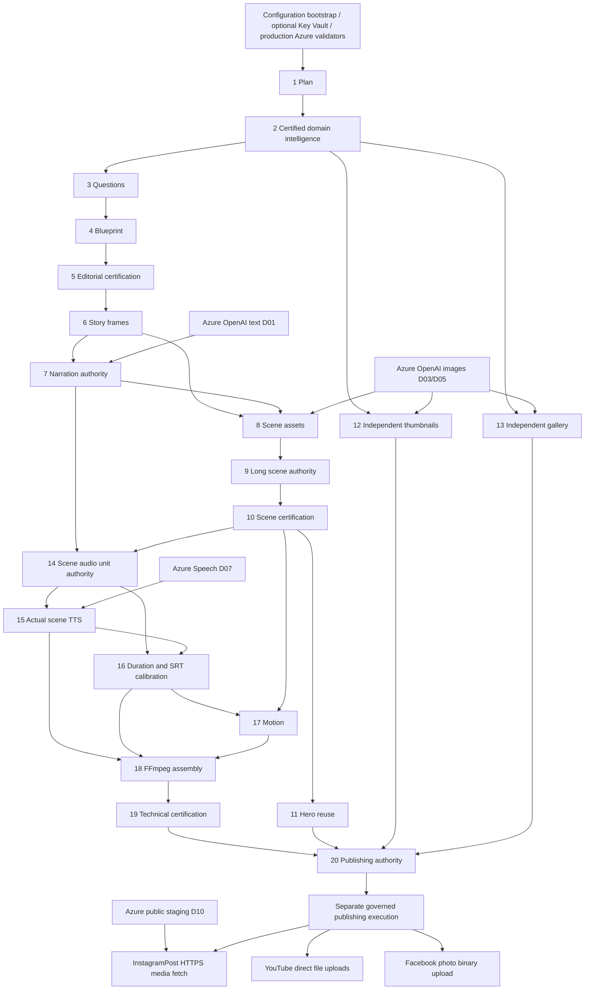

# RC2 phase dependency matrix

Audit date: 2026-10-21. Branch: `RecoveryBrach-18-05-26`. Source commit: `0e5ba735191036fdfac8c35c789805b83f03c785`. Audit only; no migration, model installation, generation, publication, or certification run was performed.

## Executable authority, not historical labels

The source of truth is `ProductionPipelineExecutionService.PhaseDefinitions()` (lines 422–444 at this commit), its dedicated phase dispatch, and called publishers. `Rc2PipelinePhaseRegistry` declares PracticalPhaseCount=21 but only descriptive definitions 1–8; that does not prove 21 executable production phases. This report maps **1–20 individually**, as requested. WeeklySkyForecast Phase 6.3 and bulk TTS Phase 9C.1 use independent numbering and must not be conflated with RC2.

- [`Backend/src/Astronomy.MediaFactory.Infrastructure/Persistence/ProductionPipelineExecutionService.cs`](../../Backend/src/Astronomy.MediaFactory.Infrastructure/Persistence/ProductionPipelineExecutionService.cs): ExecuteAsync dispatch plus PhaseDefinitions; source method names below are relative to this class.
- [`Backend/src/Astronomy.MediaFactory.Infrastructure/Orchestration/RC2/Rc2PipelinePhaseRegistry.cs`](../../Backend/src/Astronomy.MediaFactory.Infrastructure/Orchestration/RC2/Rc2PipelinePhaseRegistry.cs): Partial descriptive registry and 21 default range.
- [`Backend/src/Astronomy.MediaFactory.Infrastructure/Orchestration/RC2/Rc2ContentPlanningBatchOrchestrator.cs`](../../Backend/src/Astronomy.MediaFactory.Infrastructure/Orchestration/RC2/Rc2ContentPlanningBatchOrchestrator.cs): GenerateFromPlansAsync delegates certified production ownership; overlays are not independent phase authority.

Direct Azure AI calls are in **7, conditionally 8, 12, 13, 15**. Phases 9–11, 14, 16–20 can be transitively blocked by upstream AI-generated authority. Requested-output selection and reuse can change which phases run; no claim that every request executes all 20. All phases may also be prevented from starting by configured Key Vault or global production Azure option validation.

Each phase persists files under its own authority roots and stable validation report. “Publication” below means atomic artifact authority publication, not a social post. PostgreSQL remains the upstream plan/run and downstream OAuth/approval/publication store; do not assume one database table per phase.

## Phase 1 — Run setup / plan selection

- **Entry point:** `ProductionPipelineExecutionService.ExecutePhase1Async` in [`Backend/src/Astronomy.MediaFactory.Infrastructure/Persistence/ProductionPipelineExecutionService.cs`](../../Backend/src/Astronomy.MediaFactory.Infrastructure/Persistence/ProductionPipelineExecutionService.cs)
- **Inputs:** Request PlanId, selected plan / production request
- **AI / Azure SDK or HTTP:** None
- **Generated artifacts:** 01-plan/{selected-plan,production-request,execution-context,pipeline-state}.json; phase manifest
- **Persisted authority:** Phase1Authority projector/persistence/publication transaction; plan selection originates in PostgreSQL
- **External dependencies:** Local filesystem; PostgreSQL for upstream plan selection
- **Azure unavailable behavior:** No direct effect; a global Azure bootstrap failure can prevent process startup
- **Proposed replacement:** Keep unchanged
- **Compatibility risks:** Identity/resume/invalidation and file transaction invariants
- **Implementation evidence:** [`Backend/src/Astronomy.MediaFactory.Infrastructure/Persistence/Phase1Authority.cs`](../../Backend/src/Astronomy.MediaFactory.Infrastructure/Persistence/Phase1Authority.cs)

## Phase 2 — Domain intelligence

- **Entry point:** `ProductionPipelineExecutionService.ExecutePhase2Async` in [`Backend/src/Astronomy.MediaFactory.Infrastructure/Persistence/ProductionPipelineExecutionService.cs`](../../Backend/src/Astronomy.MediaFactory.Infrastructure/Persistence/ProductionPipelineExecutionService.cs)
- **Inputs:** P1 identity and production-event context
- **AI / Azure SDK or HTTP:** None in audited phase execution
- **Generated artifacts:** 02-intelligence/{certified-knowledge-context,observation-context,source-registry,production-intelligence-diagnostics}.json; plan-input/production-event-intelligence.json
- **Persisted authority:** Phase2IntelligenceService.ExecuteAsync / certified family knowledge context
- **External dependencies:** Local family capability/source data; upstream astronomy data may require sidecar/external sources
- **Azure unavailable behavior:** No direct Azure call; no LLM should replace certified facts
- **Proposed replacement:** Keep family capabilities/Skyfield
- **Compatibility risks:** Scientific provenance and supported family validation
- **Implementation evidence:** [`Backend/src/Astronomy.MediaFactory.Infrastructure/Persistence/Phase2EventIntelligence.cs`](../../Backend/src/Astronomy.MediaFactory.Infrastructure/Persistence/Phase2EventIntelligence.cs)

## Phase 3 — Viewer curiosity framework

- **Entry point:** `ProductionPipelineExecutionService.PhaseGenerateQuestionsAsync` in [`Backend/src/Astronomy.MediaFactory.Infrastructure/Persistence/ProductionPipelineExecutionService.cs`](../../Backend/src/Astronomy.MediaFactory.Infrastructure/Persistence/ProductionPipelineExecutionService.cs)
- **Inputs:** P2 intelligence and plan
- **AI / Azure SDK or HTTP:** No confirmed Azure call in current question engine
- **Generated artifacts:** question-answer-set.json compatibility; viewer-question-bank.json, learning-objectives.json, question-plan.json
- **Persisted authority:** Question engine publication + stable Phase3 validation
- **External dependencies:** Local source knowledge and rules
- **Azure unavailable behavior:** No direct Azure failure
- **Proposed replacement:** Keep unchanged
- **Compatibility risks:** Question/learning-objective ownership; do not substitute invented research
- **Implementation evidence:** [`Backend/src/Astronomy.MediaFactory.Infrastructure/Persistence/AstronomyQuestionEngine.cs`](../../Backend/src/Astronomy.MediaFactory.Infrastructure/Persistence/AstronomyQuestionEngine.cs)

## Phase 4 — Documentary blueprint

- **Entry point:** `ProductionPipelineExecutionService.ExecutePhase4Async` in [`Backend/src/Astronomy.MediaFactory.Infrastructure/Persistence/ProductionPipelineExecutionService.cs`](../../Backend/src/Astronomy.MediaFactory.Infrastructure/Persistence/ProductionPipelineExecutionService.cs)
- **Inputs:** P2 intelligence; P3 question bank/objectives/plan; phase manifest
- **AI / Azure SDK or HTTP:** None confirmed
- **Generated artifacts:** Documentary blueprint authority and canonical Phase4 validation
- **Persisted authority:** IDocumentaryBlueprintPhase4IntegrationService.ExecuteAsync; committed blueprint
- **External dependencies:** Local blueprint rules and files
- **Azure unavailable behavior:** No direct Azure failure
- **Proposed replacement:** Keep unchanged
- **Compatibility risks:** Transactional committed blueprint/readback; phase4 rerun must not execute phase5+
- **Implementation evidence:** [`Backend/src/Astronomy.MediaFactory.Infrastructure/DocumentaryBlueprint/DocumentaryBlueprintPhase4Integration.cs`](../../Backend/src/Astronomy.MediaFactory.Infrastructure/DocumentaryBlueprint/DocumentaryBlueprintPhase4Integration.cs)

## Phase 5 — Editorial validation

- **Entry point:** `ProductionPipelineExecutionService.ExecutePhase5Async` in [`Backend/src/Astronomy.MediaFactory.Infrastructure/Persistence/ProductionPipelineExecutionService.cs`](../../Backend/src/Astronomy.MediaFactory.Infrastructure/Persistence/ProductionPipelineExecutionService.cs)
- **Inputs:** Committed P4 blueprint
- **AI / Azure SDK or HTTP:** None
- **Generated artifacts:** Certification/summary, canonical phase-05-validation.json
- **Persisted authority:** DocumentaryBlueprintCertificationIntegrationService.CertifyAsync + Phase5PublicationTransactionCoordinator.PublishAsync
- **External dependencies:** Local certification rules
- **Azure unavailable behavior:** No direct Azure failure
- **Proposed replacement:** Keep unchanged
- **Compatibility risks:** Semantic checksum, editorial contract, certification ID
- **Implementation evidence:** [`Backend/src/Astronomy.MediaFactory.Infrastructure/DocumentaryBlueprint/Phase5PublicationTransactionCoordinator.cs`](../../Backend/src/Astronomy.MediaFactory.Infrastructure/DocumentaryBlueprint/Phase5PublicationTransactionCoordinator.cs)

## Phase 6 — Story frames authority

- **Entry point:** `ProductionPipelineExecutionService.ExecutePhase6Async / ExecuteLockedPhase6Async` in [`Backend/src/Astronomy.MediaFactory.Infrastructure/Persistence/ProductionPipelineExecutionService.cs`](../../Backend/src/Astronomy.MediaFactory.Infrastructure/Persistence/ProductionPipelineExecutionService.cs)
- **Inputs:** P4 blueprint + P5 certification/editorial contract
- **AI / Azure SDK or HTTP:** None confirmed
- **Generated artifacts:** 06-story-frames/story-frame-index.json and short/long frame authority
- **Persisted authority:** StoryFrameIntegrationService + locked authority publication
- **External dependencies:** Local certified frame builders
- **Azure unavailable behavior:** No direct Azure failure
- **Proposed replacement:** Keep unchanged
- **Compatibility risks:** Scene IDs, family/variant ownership, planned duration authority
- **Implementation evidence:** [`Backend/src/Astronomy.MediaFactory.Infrastructure/Orchestration/RC2/StoryFrameIntegrationService.cs`](../../Backend/src/Astronomy.MediaFactory.Infrastructure/Orchestration/RC2/StoryFrameIntegrationService.cs)

## Phase 7 — Narration authority

- **Entry point:** `ProductionPipelineExecutionService.ExecutePhase7NarrativeLifecycleAsync` in [`Backend/src/Astronomy.MediaFactory.Infrastructure/Persistence/ProductionPipelineExecutionService.cs`](../../Backend/src/Astronomy.MediaFactory.Infrastructure/Persistence/ProductionPipelineExecutionService.cs)
- **Inputs:** P2 knowledge; P4/5/6 committed authorities; canonical family profile
- **AI / Azure SDK or HTTP:** D01: INarrationPerformer.InvokeAsync → Azure HTTP chat
- **Generated artifacts:** 07-narration/narration-manifest.json, narration-certification.json, short/long accepted-release-candidate.json; narration-v5 drafts/diagnostics
- **Persisted authority:** Phase7NarrationAuthorityOrchestrator through committed planning; DocumentaryNarrativeLifecycleIntegrationService executes generator, acceptance and publication
- **External dependencies:** Azure OpenAI; local semantic resolver/family profile
- **Azure unavailable behavior:** Missing registration/auth/JSON/acceptance rejects phase; placeholder narration forbidden; retries bounded
- **Proposed replacement:** Ollama adapter implementing existing INarrationPerformer
- **Compatibility risks:** Structured JSON, no invented claims, Long/Short separation, provider-call evidence and accepted-release authority
- **Implementation evidence:** [`Backend/src/Astronomy.MediaFactory.Infrastructure/DocumentaryBlueprint/DocumentaryNarrativeLifecycleIntegrationService.cs`](../../Backend/src/Astronomy.MediaFactory.Infrastructure/DocumentaryBlueprint/DocumentaryNarrativeLifecycleIntegrationService.cs)

## Phase 8 — Format-aware scene assets

- **Entry point:** `ProductionPipelineExecutionService.PhaseGenerateSceneImagesAsync` in [`Backend/src/Astronomy.MediaFactory.Infrastructure/Persistence/ProductionPipelineExecutionService.cs`](../../Backend/src/Astronomy.MediaFactory.Infrastructure/Persistence/ProductionPipelineExecutionService.cs)
- **Inputs:** P6 governed visual authority and timeline context; accepted narration beats where required
- **AI / Azure SDK or HTTP:** D03 on cinematic/hybrid routes; none on explicit scientific infographic/accurate-sky authority routes
- **Generated artifacts:** 08-scene-assets/scene-asset-manifest.json, publication report; variant images and visual-timeline-v3/scene-manifest-v3/review files
- **Persisted authority:** SceneAssetsV3Service + Phase8AuthorityLoader/manifest validation
- **External dependencies:** Azure image HTTP; local scientific geometry/catalog projection; fonts/ImageSharp
- **Azure unavailable behavior:** Provider errors or invalid scientific lineage can block; deterministic fallback in some branches is not universal certification
- **Proposed replacement:** Local image adapter for permitted atmosphere; retain scientific renderers
- **Compatibility risks:** Native dimensions, style, true geometry, source IDs, PNG hashes, fallback provenance
- **Implementation evidence:** [`Backend/src/Astronomy.MediaFactory.Infrastructure/Persistence/SceneAssetsV3Service.cs`](../../Backend/src/Astronomy.MediaFactory.Infrastructure/Persistence/SceneAssetsV3Service.cs)

## Phase 9 — Long scene assets

- **Entry point:** `ProductionPipelineExecutionService.PhaseValidateLongSceneImagesAsync` in [`Backend/src/Astronomy.MediaFactory.Infrastructure/Persistence/ProductionPipelineExecutionService.cs`](../../Backend/src/Astronomy.MediaFactory.Infrastructure/Persistence/ProductionPipelineExecutionService.cs)
- **Inputs:** P8 committed scene authority
- **AI / Azure SDK or HTTP:** None directly
- **Generated artifacts:** Long-scene-image manifest/publication authority
- **Persisted authority:** LongSceneImagePublicationService.PublishAsync
- **External dependencies:** Local image files/certified lineage
- **Azure unavailable behavior:** Blocked by missing/invalid P8; no new image provider call in this dispatch
- **Proposed replacement:** Keep unchanged
- **Compatibility risks:** Do not mistake phase label Generate for an independent Azure generation call
- **Implementation evidence:** [`Backend/src/Astronomy.MediaFactory.Infrastructure/Persistence/LongSceneImagePublicationService.cs`](../../Backend/src/Astronomy.MediaFactory.Infrastructure/Persistence/LongSceneImagePublicationService.cs)

## Phase 10 — Scene asset certification

- **Entry point:** `ProductionPipelineExecutionService.PhaseValidateSceneAssetsAsync` in [`Backend/src/Astronomy.MediaFactory.Infrastructure/Persistence/ProductionPipelineExecutionService.cs`](../../Backend/src/Astronomy.MediaFactory.Infrastructure/Persistence/ProductionPipelineExecutionService.cs)
- **Inputs:** P8/P9 images, manifests and geometry evidence
- **AI / Azure SDK or HTTP:** None
- **Generated artifacts:** 10-scene-validation/scene-asset-certification.json and publication evidence
- **Persisted authority:** SceneAssetCertificationService.CertifyAsync
- **External dependencies:** Local image decode and contract checks
- **Azure unavailable behavior:** Upstream Azure generation failure prevents fresh certification
- **Proposed replacement:** Keep validator unchanged
- **Compatibility risks:** Physical SHA256, geometry certification, no fake provenance
- **Implementation evidence:** [`Backend/src/Astronomy.MediaFactory.Infrastructure/Persistence/SceneAssetCertificationService.cs`](../../Backend/src/Astronomy.MediaFactory.Infrastructure/Persistence/SceneAssetCertificationService.cs)

## Phase 11 — Responsive Hero

- **Entry point:** `ProductionPipelineExecutionService.PhaseGenerateHeroAsync` in [`Backend/src/Astronomy.MediaFactory.Infrastructure/Persistence/ProductionPipelineExecutionService.cs`](../../Backend/src/Astronomy.MediaFactory.Infrastructure/Persistence/ProductionPipelineExecutionService.cs)
- **Inputs:** P10-certified P8 cinematic/hybrid rasters
- **AI / Azure SDK or HTTP:** None on governed route; D04 exists only in legacy Hero route
- **Generated artifacts:** 11-hero/hero-asset-manifest.json; landscape/portrait/square PNG; diagnostics/publication report
- **Persisted authority:** ResponsiveHeroAuthorityService.PublishAsync
- **External dependencies:** ImageSharp/fonts; certified sources
- **Azure unavailable behavior:** Fails if certified source absent; does not call Azure to repair upstream
- **Proposed replacement:** Keep deterministic Hero compositor
- **Compatibility risks:** Protected scientific regions, 1920x1080/1080x1920/1080x1080, source SHA lineage
- **Implementation evidence:** [`Backend/src/Astronomy.MediaFactory.Infrastructure/Persistence/ResponsiveHeroAuthorityService.cs`](../../Backend/src/Astronomy.MediaFactory.Infrastructure/Persistence/ResponsiveHeroAuthorityService.cs)

## Phase 12 — Thumbnails

- **Entry point:** `ProductionPipelineExecutionService.PhaseGenerateThumbnailsAsync` in [`Backend/src/Astronomy.MediaFactory.Infrastructure/Persistence/ProductionPipelineExecutionService.cs`](../../Backend/src/Astronomy.MediaFactory.Infrastructure/Persistence/ProductionPipelineExecutionService.cs)
- **Inputs:** Certified P2 semantic authority and verified facts; current event identity
- **AI / Azure SDK or HTTP:** D03 through image interface; validates Azure image configuration explicitly
- **Generated artifacts:** 12-thumbnails/thumbnail-asset-manifest.json plus three independent aspect candidates and diagnostics
- **Persisted authority:** ResponsiveThumbnailAuthorityService → MatureThumbnailCandidatePublisher.PublishAsync
- **External dependencies:** Azure image HTTP; deterministic copy/overlay renderer
- **Azure unavailable behavior:** P12_PROVIDER_NOT_CONFIGURED or P12_PROVIDER_FAILURE; current route forbids fallback
- **Proposed replacement:** Provider-neutral validation + local image implementation; retain deterministic factual overlays
- **Compatibility risks:** Unreachable older certified-Hero thumbnail code is not current behavior; purpose-specific per-aspect art
- **Implementation evidence:** [`Backend/src/Astronomy.MediaFactory.Infrastructure/Persistence/MatureThumbnailCandidatePublisher.cs`](../../Backend/src/Astronomy.MediaFactory.Infrastructure/Persistence/MatureThumbnailCandidatePublisher.cs)

## Phase 13 — Gallery

- **Entry point:** `ProductionPipelineExecutionService.PhaseGenerateGalleryAsync` in [`Backend/src/Astronomy.MediaFactory.Infrastructure/Persistence/ProductionPipelineExecutionService.cs`](../../Backend/src/Astronomy.MediaFactory.Infrastructure/Persistence/ProductionPipelineExecutionService.cs)
- **Inputs:** Plan root/semantic authority, phase2 verified context; gallery page/topic plans
- **AI / Azure SDK or HTTP:** D05: independent static HTTP helper, not D03 DI
- **Generated artifacts:** 13-gallery/gallery-manifest.json, six independent landscape pages plus diagnostics
- **Persisted authority:** AstroPulseGalleryService.GenerateGalleryAsync → Phase13GalleryAuthority.PublishAsync
- **External dependencies:** Azure image HTTP; ImageSharp/fonts
- **Azure unavailable behavior:** P13_PROVIDER_NOT_CONFIGURED or failed page generation blocks authority
- **Proposed replacement:** Extract shared image boundary; local diffusion where policy permits
- **Compatibility risks:** Six semantic pages, role/sequence/source facts, 1792x1024 provider request; text rendered deterministically
- **Implementation evidence:** [`Backend/src/Astronomy.MediaFactory.Rendering/Phase13GalleryAuthority.cs`](../../Backend/src/Astronomy.MediaFactory.Rendering/Phase13GalleryAuthority.cs)

## Phase 14 — Scene audio sync authority

- **Entry point:** `ProductionPipelineExecutionService.PhaseSceneAudioSyncAsync` in [`Backend/src/Astronomy.MediaFactory.Infrastructure/Persistence/ProductionPipelineExecutionService.cs`](../../Backend/src/Astronomy.MediaFactory.Infrastructure/Persistence/ProductionPipelineExecutionService.cs)
- **Inputs:** P7 accepted release candidates + narration certification; P10 scene certification
- **AI / Azure SDK or HTTP:** None on governed route
- **Generated artifacts:** 14-audio-sync/narration-cue-plan.json, scene-audio-sync.json, phase14-manifest/publication report
- **Persisted authority:** Phase14AudioSyncPublisher.ExecuteAsync
- **External dependencies:** Local sentence grouping, scene audio units, estimated durations
- **Azure unavailable behavior:** Fails on missing/invalid P7 or P10, not a direct Speech request
- **Proposed replacement:** Keep authority and sentence/segment IDs
- **Compatibility risks:** Do not introduce a second subtitle authority or change scene ownership
- **Implementation evidence:** [`Backend/src/Astronomy.MediaFactory.Infrastructure/Persistence/Phase14AudioSyncPublisher.cs`](../../Backend/src/Astronomy.MediaFactory.Infrastructure/Persistence/Phase14AudioSyncPublisher.cs)

## Phase 15 — Real TTS V2

- **Entry point:** `ProductionPipelineExecutionService.PhaseGenerateTtsTimelineV1Async → Phase15RealTtsV2Async` in [`Backend/src/Astronomy.MediaFactory.Infrastructure/Persistence/ProductionPipelineExecutionService.cs`](../../Backend/src/Astronomy.MediaFactory.Infrastructure/Persistence/ProductionPipelineExecutionService.cs)
- **Inputs:** P14 SceneAudioUnits, source checksum, language/voice/style refs
- **AI / Azure SDK or HTTP:** D07: AzureSpeechClient.SynthesizeMp3Async, direct configuration gate
- **Generated artifacts:** 15-tts/{language}/<short|long>/<SceneAudioUnitId>.mp3, narration-track.mp3; tts-timeline/phase15-manifest/publication report
- **Persisted authority:** Staged scene synthesis requests + deterministic Phase15 authority based on physical audio and policy identity
- **External dependencies:** Azure Speech; ffprobe/FFmpeg for physical validation/concatenation
- **Azure unavailable behavior:** P15_TTS_PROVIDER_UNAVAILABLE; SceneLevel enforced; transactional old authority preservation
- **Proposed replacement:** Local TTS adapter, provider-aware policy version and voice mapping
- **Compatibility risks:** Exactly one unit output per request; MP3 24000Hz mono; hi- prefix constraint; model/voice provenance and new SHA
- **Implementation evidence:** [`Backend/src/Astronomy.MediaFactory.Infrastructure/Persistence/ProductionPipelineExecutionService.cs`](../../Backend/src/Astronomy.MediaFactory.Infrastructure/Persistence/ProductionPipelineExecutionService.cs)

## Phase 16 — Duration calibration

- **Entry point:** `ProductionPipelineExecutionService.PhaseDurationCalibrationV1Async` in [`Backend/src/Astronomy.MediaFactory.Infrastructure/Persistence/ProductionPipelineExecutionService.cs`](../../Backend/src/Astronomy.MediaFactory.Infrastructure/Persistence/ProductionPipelineExecutionService.cs)
- **Inputs:** P14 cue plan + P15 measured audio/authority; P6 planned durations when available
- **AI / Azure SDK or HTTP:** None
- **Generated artifacts:** 16-duration-calibration/{language}/calibrated-scene-timeline.json, subtitle-timeline.json; short/long/final.srt; phase16-manifest
- **Persisted authority:** Phase16DurationCalibrationPublisher.ExecuteAsync
- **External dependencies:** Local audio/hash checks; weighted subtitle timing
- **Azure unavailable behavior:** Blocks if P15 missing/invalid, otherwise no Azure request
- **Proposed replacement:** Keep weighted calibration baseline; optional aligner only after schema-compatible certification
- **Compatibility risks:** Do not use STT to replace approved narration; preserve exact SRT text/timing ownership
- **Implementation evidence:** [`Backend/src/Astronomy.MediaFactory.Infrastructure/Persistence/Phase16DurationCalibrationPublisher.cs`](../../Backend/src/Astronomy.MediaFactory.Infrastructure/Persistence/Phase16DurationCalibrationPublisher.cs)

## Phase 17 — Governed motion

- **Entry point:** `ProductionPipelineExecutionService.PhaseMotionLayerV1Async` in [`Backend/src/Astronomy.MediaFactory.Infrastructure/Persistence/ProductionPipelineExecutionService.cs`](../../Backend/src/Astronomy.MediaFactory.Infrastructure/Persistence/ProductionPipelineExecutionService.cs)
- **Inputs:** P16 timing + P8/9/10 certified imagery
- **AI / Azure SDK or HTTP:** None
- **Generated artifacts:** 17-motion/{language}/short|long/motion-plan.json; phase17-manifest/publication report
- **Persisted authority:** Phase17MotionAuthorityPublisher.ExecuteAsync
- **External dependencies:** Local motion planning and image geometry
- **Azure unavailable behavior:** Upstream artifact failure blocks; no direct Azure call
- **Proposed replacement:** Keep unchanged
- **Compatibility risks:** Duration/scene IDs, scientific protected regions
- **Implementation evidence:** [`Backend/src/Astronomy.MediaFactory.Infrastructure/Persistence/Phase17MotionAuthorityPublisher.cs`](../../Backend/src/Astronomy.MediaFactory.Infrastructure/Persistence/Phase17MotionAuthorityPublisher.cs)

## Phase 18 — Cinematic video assembly

- **Entry point:** `ProductionPipelineExecutionService.PhaseVideoAssemblyV1Async` in [`Backend/src/Astronomy.MediaFactory.Infrastructure/Persistence/ProductionPipelineExecutionService.cs`](../../Backend/src/Astronomy.MediaFactory.Infrastructure/Persistence/ProductionPipelineExecutionService.cs)
- **Inputs:** P15 audio, P16 SRT/timing, P17 motion, certified visuals
- **AI / Azure SDK or HTTP:** None
- **Generated artifacts:** 18-video-assembly/{language}/short|long/final.mp4, captions/{language}.srt; phase18-manifest/report
- **Persisted authority:** Phase18VideoAssemblyAuthorityPublisher.ExecuteAsync
- **External dependencies:** FFmpeg/ffprobe; fonts/codecs/filesystem
- **Azure unavailable behavior:** Cannot assemble without upstream media; no direct Azure request
- **Proposed replacement:** Keep renderer unchanged
- **Compatibility risks:** Audio mixing, short/long limits, caption single ownership; no duplicate burn-in
- **Implementation evidence:** [`Backend/src/Astronomy.MediaFactory.Infrastructure/Persistence/Phase18VideoAssemblyAuthorityPublisher.cs`](../../Backend/src/Astronomy.MediaFactory.Infrastructure/Persistence/Phase18VideoAssemblyAuthorityPublisher.cs)

## Phase 19 — Technical QA and review

- **Entry point:** `ProductionPipelineExecutionService.PhaseVideoQaProductionReviewAsync` in [`Backend/src/Astronomy.MediaFactory.Infrastructure/Persistence/ProductionPipelineExecutionService.cs`](../../Backend/src/Astronomy.MediaFactory.Infrastructure/Persistence/ProductionPipelineExecutionService.cs)
- **Inputs:** P18 manifest/files, P15/P17 authority evidence
- **AI / Azure SDK or HTTP:** None
- **Generated artifacts:** 19-video-qa/{language}/phase19-manifest.json, qa-report.json, video-review.json, diagnostics/report
- **Persisted authority:** Phase19VideoQaAuthorityPublisher.ExecuteAsync
- **External dependencies:** ffprobe/audio/video analysis; local hash validation
- **Azure unavailable behavior:** Rejects invalid media or lineage; do not bypass when using local models
- **Proposed replacement:** Keep certification unchanged
- **Compatibility risks:** Historical certified artifacts immutable; new media must earn new certification
- **Implementation evidence:** [`Backend/src/Astronomy.MediaFactory.Infrastructure/Persistence/Phase19VideoQaAuthorityPublisher.cs`](../../Backend/src/Astronomy.MediaFactory.Infrastructure/Persistence/Phase19VideoQaAuthorityPublisher.cs)

## Phase 20 — Publishing package authority

- **Entry point:** `ProductionPipelineExecutionService.PhaseFinalValidationAsync` in [`Backend/src/Astronomy.MediaFactory.Infrastructure/Persistence/ProductionPipelineExecutionService.cs`](../../Backend/src/Astronomy.MediaFactory.Infrastructure/Persistence/ProductionPipelineExecutionService.cs)
- **Inputs:** P19 certification, P18 media, requested P11/12/13 supporting outputs
- **AI / Azure SDK or HTTP:** None directly; D10 required later for actual Instagram image publication
- **Generated artifacts:** 20-publishing/{language}/publishing-manifest.json, publishing-package.json, diagnostics/report
- **Persisted authority:** Phase20PublishingAuthorityPublisher.ExecuteAsync; later DB Rc2PublishingApproval/Publication records belong to publishing services
- **External dependencies:** Local manifest/hash validation; social APIs only in later publishing execution
- **Azure unavailable behavior:** Fails invalid/missing requested roles; does not itself upload/publish or renew Azure URLs
- **Proposed replacement:** Keep package semantics; change staging provider behind later publishing boundary
- **Compatibility risks:** PublishingPackageId, authority checksum, role/path, approval identity and idempotency
- **Implementation evidence:** [`Backend/src/Astronomy.MediaFactory.Infrastructure/Persistence/Phase20PublishingAuthorityPublisher.cs`](../../Backend/src/Astronomy.MediaFactory.Infrastructure/Persistence/Phase20PublishingAuthorityPublisher.cs)

## Dependency graph

This is a dependency graph, not a complete scheduling diagram. P8's image edge is conditional on scene policy; P12/P13 edges apply when those outputs are required. Existing certified artifacts can be read without recontacting their original AI providers if all authority/reuse guards pass.
