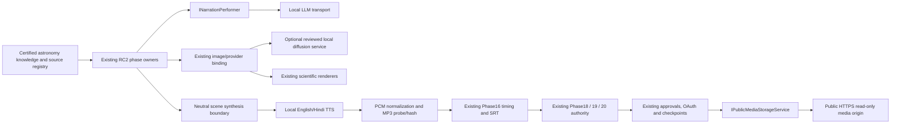

# Provider-independent architecture and public storage

Audit date: 2026-10-21. Branch: `RecoveryBrach-18-05-26`. Source commit: `0e5ba735191036fdfac8c35c789805b83f03c785`. Audit only; no migration, model installation, generation, publication, or certification run was performed.

## Minimal architecture proposal

Keep the pipeline, phase publishers, PlanId, scene IDs, canonical file paths, artifact roles, SHA256 checks, acceptance policies and Phase19/20 certification unchanged. Put replacement implementations at existing service boundaries, and remove Azure-specific readiness checks **only after equivalent selected-provider validation exists**. This report proposes changes; none were implemented.

| Requested capability | Existing abstraction to reuse | Minimal gap / future change |
|---|---|---|
| ITextGenerationProvider | `INarrationPerformer`, `IScriptGenerationService`, `IShortsScriptGenerationService`, `IMetadataOptimizationModelClient`, `IAIOptimizationService` | Implement a shared local transport internally; keep typed service results. Route separate AIOptimizationService HTTP call through it. Do not add another public text facade unless these cannot express a measured requirement. |
| ITextToSpeechProvider | `ISpeechSynthesisService`, `ITtsAudioGenerationService`, `IWeeklySkyForecastTtsSynthesizer`, `IDocumentaryNarrationProviderBinding` | RC2 Phase15 directly uses AzureSpeechOptions/IAzureSpeechClient. A neutral low-level scene synthesis boundary is justified there; adapters must preserve existing outer contracts and physical audio authority. |
| ISpeechTranscriptionProvider | No confirmed equivalent/current STT usage | Do not introduce an unused production interface. Add only for an approved independent QA capability after proving need. |
| ISpeechAlignmentProvider | `IDocumentarySubtitleProviderBinding`, existing Phase16 weighted calibration | Reuse subtitle boundary for optional alignment where applicable; keep Phase16 sole RC2 SRT publisher. Add a small internal aligner interface only if the current binding cannot represent known-transcript alignment. |
| IImageGenerationProvider | `IAICinematicImageGenerator` / `IAICinematicAssetGenerator`, `IDocumentaryVisualProviderBinding` | Implement reviewed local image generation; extract Gallery/Hero/Visual Lab direct HTTP into the same capability. Preserve policy-aware scientific renderers, typed provider results and no-fallback routes. |
| IEmbeddingProvider | No embedding/vector feature found | Do not add now. If approved later, version models and indexes separately. |
| IMediaStorageProvider | `IAzureBlobStorageService` (name is provider-specific, contract already abstract), `IPublicMediaStorageService` | Implement local archival and HTTPS staging behind existing signatures first; any rename should be a separate reviewed compatibility change. Preserve opaque object keys and CreateReadAccessAsync renewal. |

## Data flow and authority boundaries

The public media origin serves **provider derivatives** prepared by `ProviderMediaPreparationService`, not mutated certified originals. A storage upload does not change PublishingPackageId, approval checksum, artifact role or certification. No local runtime or storage result may claim it was Azure; new generated media obtains new truthful provenance and authority checksums. Previously certified artifacts remain readable under their original policies and identities.

## Public media design without Azure

A filesystem implementation is the lowest-complexity initial archival/staging choice. Mount a durable private data volume outside the checkout; use a dedicated staging subtree indexed by PlanId/package/checksum/role. Keep approved originals and OAuth databases private. A separate public HTTPS origin (for example Caddy or nginx plus a small signed-URL verifier) maps an opaque asset key to one allowlisted file. No upload, directory listing, arbitrary file path, executable content or admin endpoint is public.

Requirements for proposed IPublicMediaStorageService implementation:

1. Validate regular file, actual media type, byte length and hash; create a copy/derivative in the owned staging root using atomic rename. Preserve content identity and never rewrite original Phase20 paths.
2. Return existing PublicMediaUploadResult fields. `BlobName` can remain an opaque portable key for compatibility; it must not require Azure semantics. `CreateReadAccessAsync` renews access to the same content, not a duplicate upload/social post.
3. Serve a publicly resolvable domain with valid TLS on port 443. Meta must fetch without cookies, interactive auth, localhost routing or private VPN. Signed GET URL authorization is acceptable only after real fetch compatibility is verified. A short-lived onboarding machine cannot be assumed to be an always-on public origin.
4. Sign normalized key, expiry and audience/policy with an HMAC secret held outside config/source. Validate in constant time, reject traversal, symlink escapes, missing/expired keys and unsupported methods. Use read-only GET/HEAD and support byte ranges/content length/MIME as required by clients. Redact tokens from logs and referrers; rate-limit abuse without blocking legitimate Meta fetches.
5. Keep current 24-hour SAS-style lifetime as a **compatibility starting policy**, not a documented Meta minimum. Verify fetch/poll/retry delays and renew before an approved retry if needed. Never delete objects for an in-progress or uncertain remote publication.
6. Proposed retention: retain staging at least 7 days after verified completion and until all retries/uncertain outcomes reconcile; retain a failed job's staging for investigation under an explicit bounded policy. Archive certified originals with immutable hashes under a separately approved retention/backup policy (30 days hot is a sizing example, not permission to delete current data). Deletion only through a governed future cleanup feature.
7. Test external access from outside the machine, expiry/renewal, range requests, correct TLS chain, and actual provider fetch. A local curl or HEAD alone does not validate Meta reachability. No public origin was provisioned/tested in this audit.

MinIO is an optional future S3-compatible backend behind the same contract. It still needs public HTTPS, presigned URL validation, durable storage/backups, patching, and license/source-obligation review. Do not rename a local MinIO endpoint to “public” and assume Meta can reach it. Avoid adding an object-store cluster when a secure durable filesystem origin meets the measured workload.

RC2 YouTube uploads local files directly. Current RC2 Facebook **photo** publication sends binary image data and explicitly avoids the Instagram public URL/container path; do not generalize this to every legacy Facebook video path. Legacy Instagram reels and Meta thumbnails do use public staging and remain in scope.

## Security and feature preservation

Bind inference services to loopback or an authenticated private network; no anonymous public Ollama/ComfyUI/model upload API. Enforce model allowlists, request size/token/image limits, finite deadlines, cancellation and concurrency queues. Signed model manifests/checksums and authoritative downloads belong to M0; do not execute unknown custom nodes or downloaded code automatically.

Keep source knowledge trusted over model instructions; do not allow external source prose to override claim policy or publishing approvals. Do not copy OAuth tokens, user secrets or signed media URLs into prompts/diagnostics. Store social credentials with existing encryption/OS protections or reviewed secret mounts; local inference removes Azure auth needs, not YouTube/Meta OAuth. Audit backup restore, access control and container permissions.

Critical invariants: PlanId, phase boundaries/roots, HeroLandscape/HeroPortrait/HeroSquare, ThumbnailLandscape/ThumbnailPortrait/ThumbnailSquare, GalleryImage, ShortVideo/LongVideo, caption roles, SHA256, Phase19 certification, Phase20 authority checksum/PublishingPackageId, existing approvals, YouTubeLong/YouTubeShort/InstagramPost records, Facebook checkpoints, token lifecycle and remote idempotency. Changing providers is not permission to reissue old publishing packages or recertify history.

## Repository evidence

- [`Backend/src/Astronomy.MediaFactory.ContentGen/NarrationPerformer.cs`](../../Backend/src/Astronomy.MediaFactory.ContentGen/NarrationPerformer.cs): Existing text boundary.
- [`Backend/src/Astronomy.MediaFactory.Core/Interfaces.cs`](../../Backend/src/Astronomy.MediaFactory.Core/Interfaces.cs): Typed script/speech/storage/public-media and social API interfaces.
- [`Backend/src/Astronomy.MediaFactory.Core/TtsAudioGeneration.cs`](../../Backend/src/Astronomy.MediaFactory.Core/TtsAudioGeneration.cs): Existing bulk/pilot TTS service contracts.
- [`Backend/src/Astronomy.MediaFactory.Core/WeeklySkyForecast/AICinematicAssets/WeeklyAICinematicAssets.cs`](../../Backend/src/Astronomy.MediaFactory.Core/WeeklySkyForecast/AICinematicAssets/WeeklyAICinematicAssets.cs): Image generator contracts.
- [`Backend/src/Astronomy.MediaFactory.ProductionAdapters/NarrationAdapter.cs`](../../Backend/src/Astronomy.MediaFactory.ProductionAdapters/NarrationAdapter.cs): Documentary narration provider interface and physical inspection.
- [`Backend/src/Astronomy.MediaFactory.ProductionAdapters/SubtitleAdapter.cs`](../../Backend/src/Astronomy.MediaFactory.ProductionAdapters/SubtitleAdapter.cs): Subtitle interface and inspector.
- [`Backend/src/Astronomy.MediaFactory.ProductionAdapters/ExistingVisualProviderBindings.cs`](../../Backend/src/Astronomy.MediaFactory.ProductionAdapters/ExistingVisualProviderBindings.cs): Current documentary provider bindings.
- [`Backend/src/Astronomy.MediaFactory.Infrastructure/Persistence/ProductionPipelineExecutionService.cs`](../../Backend/src/Astronomy.MediaFactory.Infrastructure/Persistence/ProductionPipelineExecutionService.cs): Phase15 direct coupling and all canonical phase dispatch.
- [`Backend/src/Astronomy.MediaFactory.Infrastructure/Orchestration/RC2/ProviderMediaPreparationService.cs`](../../Backend/src/Astronomy.MediaFactory.Infrastructure/Orchestration/RC2/ProviderMediaPreparationService.cs): Provider derivative preparation separate from certified originals.
- [`Backend/src/Astronomy.MediaFactory.Infrastructure/Orchestration/RC2/Rc2PublishingExecutionService.cs`](../../Backend/src/Astronomy.MediaFactory.Infrastructure/Orchestration/RC2/Rc2PublishingExecutionService.cs): Approval/checkpoint execution, URL renewal, direct Facebook photo upload.
- [`Backend/src/Astronomy.MediaFactory.Publishing/AzureBlobPublicMediaStorageService.cs`](../../Backend/src/Astronomy.MediaFactory.Publishing/AzureBlobPublicMediaStorageService.cs): Existing upload/result/renewal and masked URL behavior.
- [`Backend/src/Astronomy.MediaFactory.Infrastructure/Persistence/Phase20PublishingAuthorityPublisher.cs`](../../Backend/src/Astronomy.MediaFactory.Infrastructure/Persistence/Phase20PublishingAuthorityPublisher.cs): Manifest-only package authority and required role resolution.
